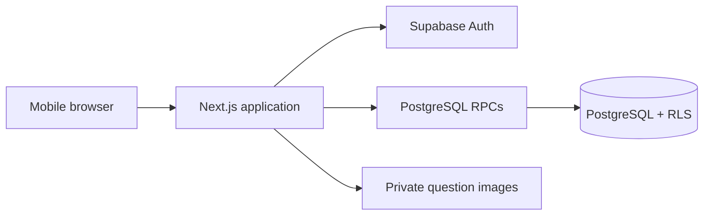
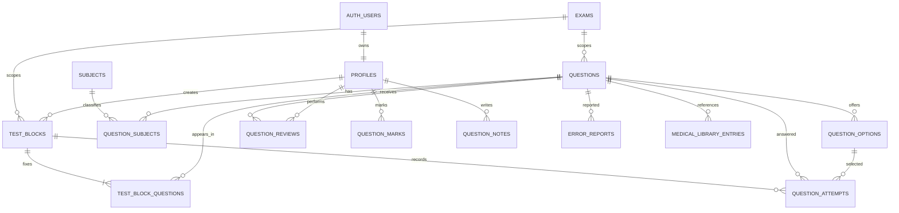
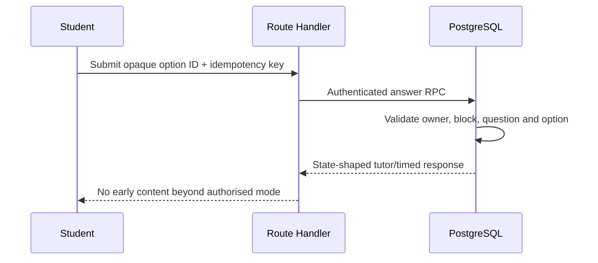

# Architecture

MediNexus is a Next.js modular monolith deployed as one application, backed by Supabase Auth, PostgreSQL and private Storage. Server Components render private pages; narrow Route Handlers and PostgreSQL functions own mutations. RLS and security-definer functions form the data boundary.

## Core data model

Taxonomy junctions for systems, disciplines and categories follow the same pattern as `question_subjects`. Block membership is immutable once generated; attempt rows use submission keys for idempotency.

## Answer request flow

